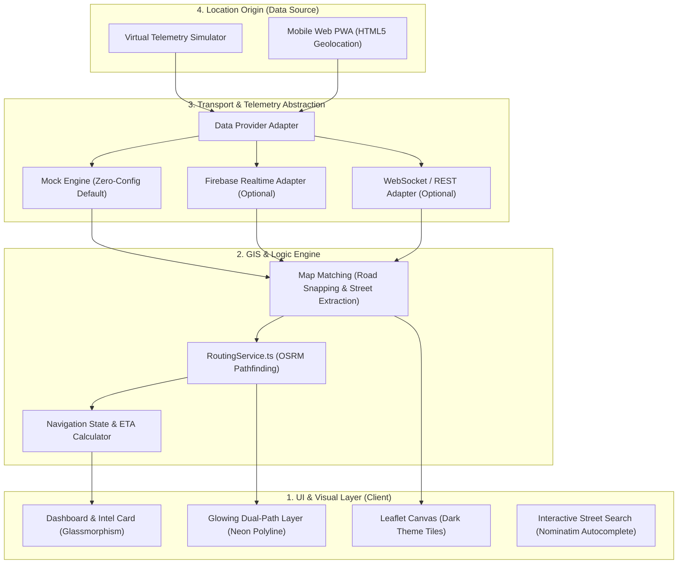
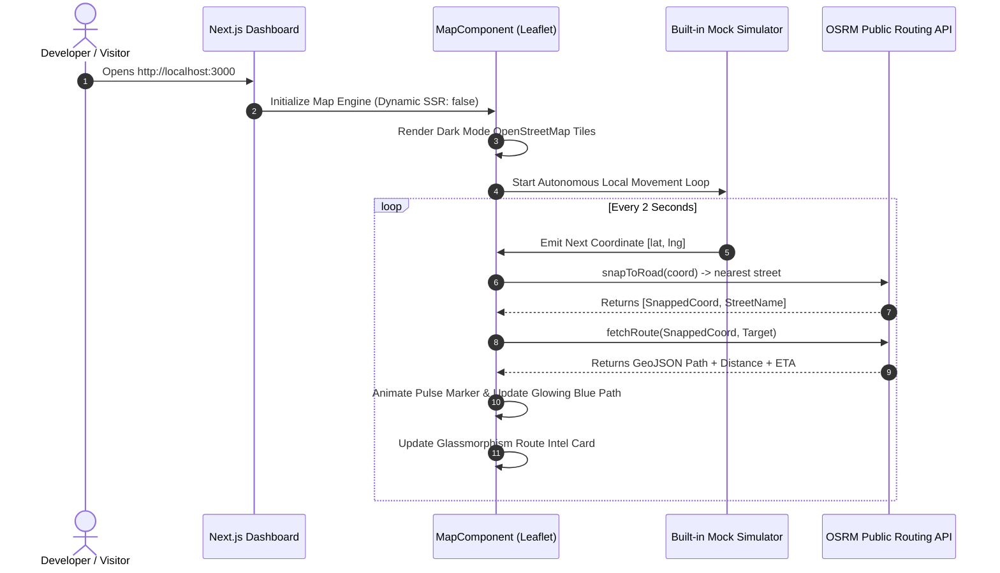
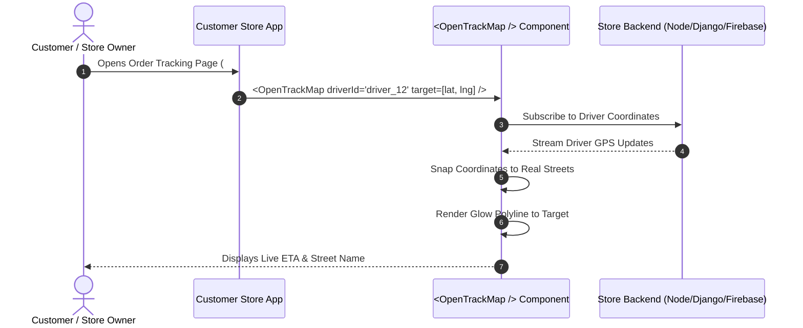
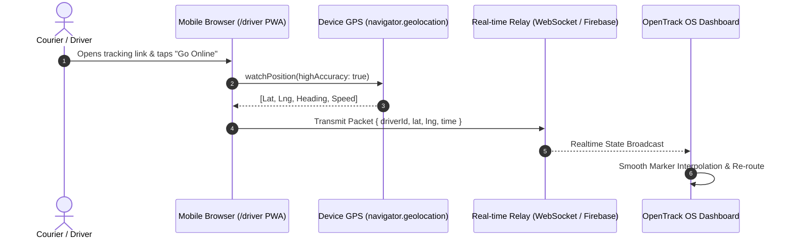
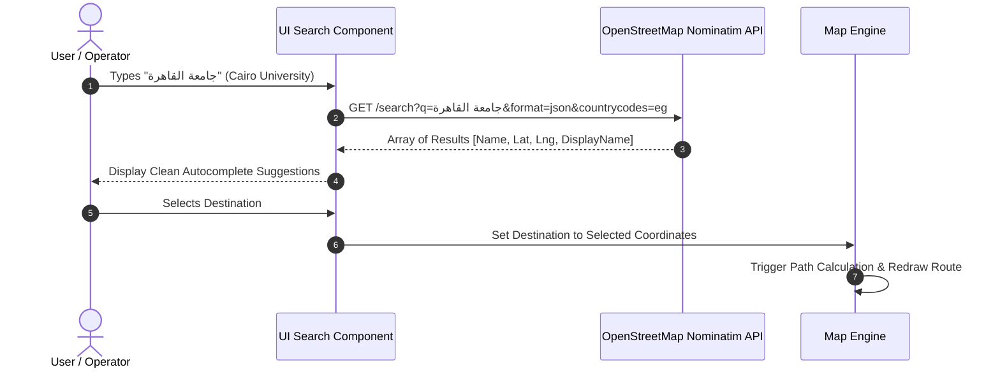
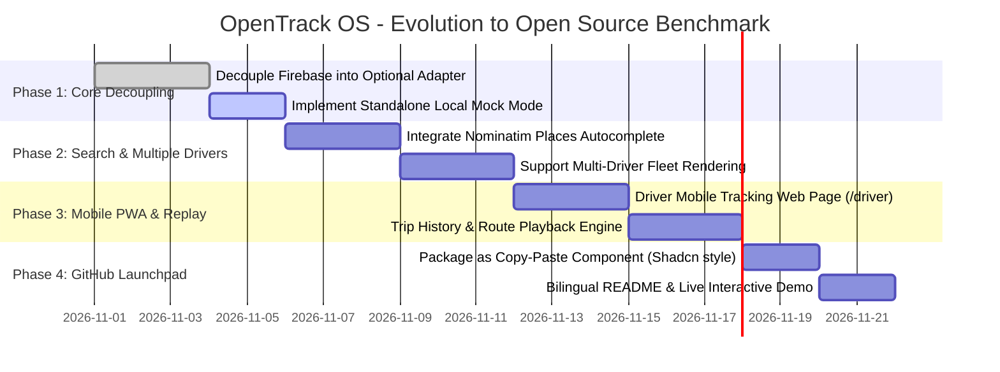

# OpenTrack OS - Architecture & Scenarios Roadmap 🗺️🚀
> **The Zero-Cost, Plug-and-Play Open Source Alternative to Google Maps & Fleet Engine for React & Next.js**

---

## 1. High-Level Architecture Overview

OpenTrack OS is structured into four decoupled layers, ensuring it can function **100% standalone with zero backend setup**, or plug into custom backends (Firebase, WebSockets, Supabase, REST APIs).



---

## 2. Detailed Technical Scenarios

### 🎬 Scenario A: Instant Standalone / Mock Mode (The "Zero-Setup" Experience)
**Goal:** A developer clones the repo from GitHub and runs `npm run dev`. The map, moving vehicle, neon route, and telemetry MUST work instantly out-of-the-box without touching an API key, database, or credit card.



---

### 🎬 Scenario B: Developer Drop-in Embedding (Using OpenTrack in Another App)
**Goal:** A software engineer wants to embed live courier tracking into an existing E-commerce or Delivery store (replacing Google Maps).



---

### 🎬 Scenario C: Real Mobile Driver PWA (0$ Cost Mobile Tracking)
**Goal:** The delivery driver uses their mobile smartphone to transmit live coordinates without requiring an app store developer license.



---

### 🎬 Scenario D: Zero-Cost Places Search (Nominatim / Photon)
**Goal:** The user searches for a destination (e.g. "Tahrir Square" or "عباس العقاد") without paying Google Places API fees.



---

## 3. Implementation Roadmap (Phases to GitHub Release)



---

## 4. Component Interface Contract (`<OpenTrackMap />`)

```typescript
export interface OpenTrackMapProps {
  // Origin & Target Coordinates [lat, lng]
  initialPosition?: [number, number];
  destination?: [number, number];

  // Routing Configuration
  routingEnabled?: boolean;
  routingProfile?: 'driving' | 'walking' | 'cycling';
  customOsrmUrl?: string; // Optional: self-hosted instance

  // Data Source Mode
  mode?: 'mock' | 'firebase' | 'websocket' | 'custom';
  telemetryStream$?: Observable<{ lat: number; lng: number }>;

  // Styling Customization
  theme?: 'dark-neon' | 'cyberpunk' | 'light-minimal';
  routeColor?: string;
  glowColor?: string;

  // Callbacks
  onRouteCalculated?: (info: { distance: number; duration: number; street: string }) => void;
  onDestinationReached?: () => void;
}
```
