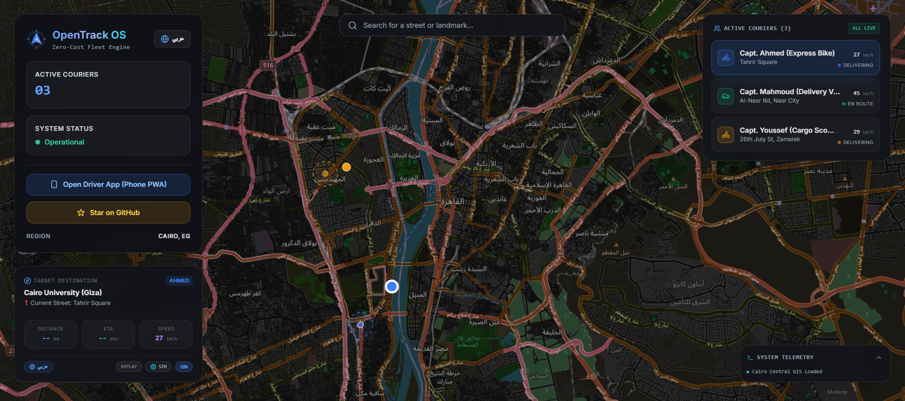

<div align="center">
  <a href="https://github.com/mohamed-khairy-5i/opentrack-os">
    
  </a>
  <h1 align="center">أوبن تراك (OpenTrack OS)</h1>
  <p align="center"><strong>البديل المجاني مفتوح المصدر 100% ($0 / 0 ج.م) لـ Google Maps و Google Fleet Engine لمطوري React و Next.js.</strong></p>
</div>

<div align="center">

[](README.md)
[](LICENSE)
[](https://nextjs.org/)
[](https://www.typescriptlang.org/)
[](https://tailwindcss.com/)
[](https://leafletjs.com/)
[](http://project-osrm.org/)
[-success)](#لماذا-أوبن-تراك؟)

<br />

[](https://opentrack-os.pages.dev)
[](https://opentrack-os.pages.dev/driver)

<br /><br />



</div>

---

## 🌟 لماذا بنينا OpenTrack OS؟

تفرض منصة **Google Maps Platform** رسوماً باهظة تبدأ من **5 إلى 10 دولارات لكل 1,000 استدعاء للملاحة**، وتصل إلى آلاف الدولارات شهرياً لخدمة تتبع الأساطيل (Google Fleet Engine).  
بالنسبة للشركات الناشئة والمطورين في مصر والعالم العربي، ومع قيود بطاقات الائتمان بالدولار، تصبح هذه التكاليف عائقاً كبيراً أمام إطلاق أي تطبيق توصيل أو شحن.

**OpenTrack OS** صُمم لكسر هذا الاحتكار؛ مكون متكامل وجاهز للإنتاج يوفر تتبعاً حياً للأساطيل وتوجيهاً حقيقياً بين الشوارع باستخدام أحدث أدوات المصادر المفتوحة — **مجاني تماماً للأبد، بدون أي كروت بنكية، وبدون الحاجة لأي مفاتيح API.**

---

## ✨ المميزات الرئيسية

### 🧭 1. ملاحة وتوجيه بين شوارع المدينة الحقيقية (OSRM)
* **مسارات شوارع حقيقية:** حساب المسار عبر الكباري، التقاطعات، والانعطافات الواقعية بدلاً من الخطوط المستقيمة البدائية.
* **خط نيون مزدوج متوهج (Cyberpunk Neon Glow):** تصميم بصري عصري بخط رئيسي حاد محاط بهالة ضوئية نيون ناعمة.
* **مطابقة الطرق وتحديد الشوارع (Map Matching):** جذب إحداثيات الـ GPS الخام إلى أقرب طريق مسفلت واستخراج اسم الشارع باللغة العربية (مثل: *ميدان التحرير*، *طريق النصر*).

### 🔍 2. بحث فوري عن الشوارع والمعالم (Nominatim Geocoding)
* **إكمال تلقائي ذكي:** ابحث عن أي شارع، حي، أو معلم في القاهرة ومصر مع اقتراحات فورية بدون أي تكلفة.

### 🚴 3. أسطول متعدد وتتبع حي (Multi-Courier Fleet)
* **دعم كباتن متعددين:** مراقبة متزامنة لمندوبي التوصيل (دراجة سريعة، فان توصيل، سكوتر شحن) بسرعاتهم وألوانهم المستقلة.
* **درج الأسطول التفاعلي:** التبديل الفوري والتركيز على أي سائق بضغطة زر.

### 📱 4. تطبيق السائق المتنقل (Mobile PWA)
* **تطبيق ويب مجاني بالكامل:** صفحة مخصصة للسائقين على المسار `/driver` تعمل من أي متصفح هاتف ذكي.
* **زر "بدء الوردية":** استخدام حساس الـ GPS في الهاتف (`navigator.geolocation.watchPosition`) لبث الإحداثيات والسرعة ودقة الموقع.
* **بث لحظي بدون سيرفرات:** نقل الإحداثيات فورياً للداشبورد عبر تقنية `BroadcastChannel` الأصلية في المتصفح.

### 🎯 5. سياج جغرافي ذكي (Geofencing Arrival Alert)
* **دائرة تسليم مرئية:** تحديد نطاق وصول تلقائي (350 متراً) حول وجهة كل عميل.
* **تنبيه وصول فوري:** إشعار تفاعلي أخضر يظهر بمجرد دخول السائق نطاق تسليم العميل.

### ⏱️ 6. محاكي إعادة تشغيل الرحلات (Trip History Replay)
* شريط تحكم لمراجعة مسار الرحلة السابقة مع أزرار تشغيل، إيقاف، وشريط زمني تفاعلي (0% إلى 100%).

---

## 🚀 البدء السريع (خلال 60 ثانية)

### 1. استنساخ المستودع والتثبيت
```bash
git clone https://github.com/mohamed-khairy-5i/opentrack-os.git
cd opentrack-os
npm install
```

### 2. تشغيل السيرفر المحلي
```bash
npm run dev
```
افتح الرابط [http://localhost:3000](http://localhost:3000) في المتصفح لمشاهدة الخريطة والداشبورد الحي!

### 3. فتح تطبيق السائق
افتح [http://localhost:3000/driver](http://localhost:3000/driver) من هاتفك أو في لسان متصفح آخر واضغط **"بدء الوردية (أونلاين)"** لبث موقعك الحي مباشرة إلى الخريطة!

---

## 📦 كيفية دمج المكون في تطبيقك الخاص (Shadcn Style)

يمكنك نسخ واستيراد المكون `<OpenTrackMap />` داخل أي مشروع Next.js أو React بسطرين فقط:

```tsx
import dynamic from "next/dynamic";

// 1. استيراد ديناميكي مع تعطيل SSR لتوافق مكتبة Leaflet
const OpenTrackMap = dynamic(
  () => import("@/components/map/OpenTrackMap").then((mod) => mod.OpenTrackMap),
  { ssr: false }
);

// 2. وضعه في صفحة تتبع الطلبات أو لوحة التحكم
export default function OrderTrackingPage() {
  return (
    <div className="relative w-full h-screen">
      {/* دعم اللغة العربية بشكل افتراضي */}
      <OpenTrackMap language="ar" />
    </div>
  );
}
```

---

## 🛠️ التقنيات المستخدمة والمعمارية

| الطبقة | التقنية مفتوحة المصدر | الغرض |
| :--- | :--- | :--- |
| **إطار العمل** | Next.js 14 (App Router) + React 18 | بنية React حديثة وسريعة مع تحميل ديناميكي للعميل |
| **محرك الخرائط** | Leaflet + OpenStreetMap Carto | خريطة نقطية داكنة خفيفة ومستقرة بدون انهيارات WebGL |
| **الملاحة والتوجيه** | OSRM (Open Source Routing Machine) | حساب المسارات والشوارع الواقعية والمسافات وETA |
| **البحث والعنونة** | OpenStreetMap Nominatim API | بحث فوري عن الشوارع والمعالم بدون مفاتيح API |
| **الحركات والواجهة** | Framer Motion + Tailwind CSS | تصميم داكن زجاجي أنيق متوافق مع كافة الشاشات |
| **اللغات والترجمة** | نظام i18n داخلي فائق الخفة (Zero Dependencies) | دعم كامل للغتين العربية والإنجليزية مع RTL/LTR |
| **نقل الإحداثيات** | المحاكاة الذاتية + BroadcastChannel | بث مجاني فوري للإحداثيات بين الهواتف والمتصفحات |

---

## 📁 هيكلة المشروع (Repository Structure)

```text
opentrack-os/
├── docs/                          # أدلة المعمارية والتصاميم
│   ├── ARCHITECTURE.md            # المخططات الهندسية وسيناريوهات Mermaid
│   └── ROUTE_STYLING.md           # دليل تخصيص ألوان وتوهج مسار النيون
├── public/                        # الأصول والشعارات العامة
│   ├── icon.svg                   # أيقونة المتصفح الفيكتور
│   └── logo.svg                   # شعار وبانر المشروع الرسمي
├── src/
│   ├── app/
│   │   ├── page.tsx               # لوحة التحكم الرئيسية
│   │   ├── driver/page.tsx        # تطبيق السائق PWA
│   │   ├── layout.tsx             # التخطيط العام
│   │   └── globals.css            # متغيرات النيون وتنسيقات الـ Dark Mode
│   ├── components/
│   │   ├── map/
│   │   │   └── OpenTrackMap.tsx   # نواة الخريطة والملاحة الرسمية
│   │   ├── dashboard/             # بطاقات الواجهة المعيارية المستقلة
│   │   │   ├── SearchBar.tsx      # شريط البحث والإكمال التلقائي
│   │   │   ├── FleetDrawer.tsx    # درج قائمة السائقين النشطين
│   │   │   ├── RouteInfoCard.tsx  # بطاقة بيانات المسار والشارع والمقاييس
│   │   │   ├── SystemLogsDrawer.tsx # تيرمينال السجلات المنبثق
│   │   │   └── TripPlaybackBar.tsx # شريط إعادة تشغيل مسار الرحلة
│   │   └── icons/
│   │       └── OpenTrackLogo.tsx  # اللوجو الفيكتور النقي
│   ├── lib/
│   │   ├── i18n.ts                # قاموس اللغات المزدوج (العربية / الإنجليزية)
│   │   ├── routing.ts             # محرك OSRM الملاحي ومطابقة الشوارع
│   │   └── search.ts              # محرك Nominatim للبحث الجغرافي
│   └── types/
│       └── fleet.ts               # التعريفات المشتركة
├── .env.example                   # قالب الإعدادات الاختياري
├── LICENSE                        # رخصة MIT
├── package.json
└── tsconfig.json
```

---

## 📄 الترخيص (License)

هذا المشروع مرخص تحت رخصة **MIT** - راجع ملف [LICENSE](LICENSE) للتفاصيل.  
متاح مجاناً 100% للاستخدام الشخصي، والتعليمي، والتجاري في أي شركة أو مشروع ناشئ.
